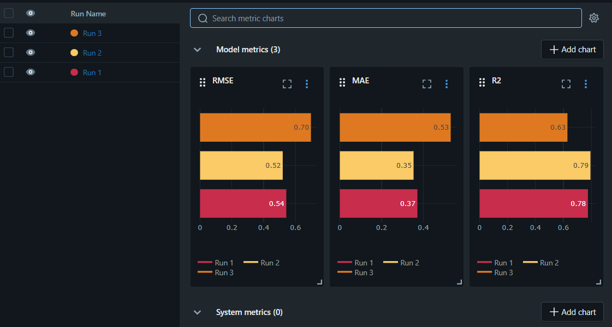

# MLflow Experiment Tracking – House Price Prediction

## 1. Task Description
Train the same machine learning model (GradientBoostingRegressor) on the California Housing dataset using different hyperparameters and use MLflow to record: Parameters, Metrics, Model artifacts and Experiment results and identify the best-performing model.

## 2. How to Run
```bash
pip install -r requirements.txt
python train.py
mlflow ui   # open http://127.0.0.1:5000
```

## 3. MLflow Results


## 4. Comparison Table

| Run Name | Max Depth | Learning Rate | RMSE | MAE | R2 |
| --- | --- | --- | --- | --- | --- |
| Run 1 | 3 | 0.1 | 0.54 | 0.37 | 0.78 |
| Run 2 | 5 | 0.05 | 0.52 | 0.35 | 0.79 |
| Run 3 | 7 | 0.01 | 0.7 | 0.53 | 0.63 |

## 5. Selected Best Model
Run 2 – max_depth = 5, learning_rate = 0.05

## 6. Why This Model?
Selected using RMSE as the primary metric (lowest = best). It also had the best
MAE and R² (lowest MAE, highest R²).